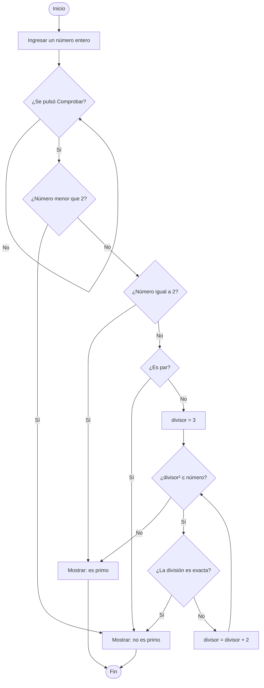

# Verificador de números primos

Esta aplicación web, construida con **Python** y **Streamlit**, permite ingresar un número entero y comprobar si es primo. La persona escribe o selecciona un valor y pulsa **Comprobar**; la aplicación muestra un mensaje indicando el resultado.

## ¿Qué considera la aplicación?

Un número primo es un entero mayor que 1 que solo tiene dos divisores positivos: 1 y él mismo. Por eso, los números negativos, el 0 y el 1 no son primos. El 2 sí es primo; cualquier otro número par mayor que 2 no lo es.

Para los números impares, el programa prueba posibles divisores impares empezando por 3. Solo necesita revisar hasta la raíz cuadrada del número: si tuviera un divisor mayor, también tendría uno menor que la raíz. Si encuentra un divisor exacto, informa que el número no es primo; si termina la búsqueda sin encontrarlo, informa que sí es primo.

El campo de entrada acepta enteros entre `-1.000.000.000.000.000` y `1.000.000.000.000.000`.

## Seudocódigo

```text
INICIO
    mostrar título e instrucciones
    leer número entero cuando la persona lo ingrese

    cuando se pulse «Comprobar»:
        SI número < 2:
            resultado ← no primo
        SINO SI número = 2:
            resultado ← primo
        SINO SI número es divisible por 2:
            resultado ← no primo
        SINO:
            divisor ← 3
            mientras divisor × divisor ≤ número:
                SI número es divisible por divisor:
                    resultado ← no primo
                    terminar búsqueda
                divisor ← divisor + 2

            SI no se encontró ningún divisor:
                resultado ← primo

        mostrar resultado
FIN
```

## Diagrama de flujo



## Ejecutar en tu computador

1. Instala Python 3.9 o posterior.
2. Abre una terminal en la carpeta del proyecto.
3. Instala la dependencia:

   ```bash
   pip install -r requirements.txt
   ```

4. Inicia la aplicación:

   ```bash
   streamlit run app.py
   ```

Streamlit abrirá la aplicación en tu navegador. Si no lo hace automáticamente, visita la dirección local que indique la terminal.

## Publicar en Streamlit Community Cloud

1. Sube `app.py` y `requirements.txt` a un repositorio de GitHub.
2. Entra a [Streamlit Community Cloud](https://share.streamlit.io/) e inicia sesión con GitHub.
3. Crea una aplicación nueva y selecciona el repositorio y la rama.
4. Especifica `app.py` como archivo principal y pulsa **Deploy**.

No hacen falta secretos ni otros paquetes para esta aplicación.
